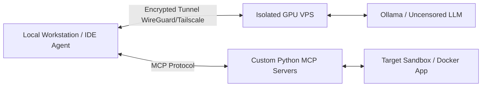

# 🛡️ Independent LLM Security Agent (`independent-LLM-agent`)

---

### 🌐 Overview / Описание / Beschreibung

* **EN:** An independent, privacy-first AI security agent powered by uncensored open-weight LLMs. Designed to run in isolated environments via encrypted tunnels, utilizing the Model Context Protocol (MCP) for automated vulnerability analysis, PoC verification, and secure code patching.
* **RU:** Независимый ИИ-агент для кибербезопасности с приоритетом на приватность, работающий на базе открытых языковых моделей без цензуры. Разработан для запуска в изолированных средах через зашифрованные туннели с использованием протокола MCP для автоматического анализа уязвимостей, проверки PoC и генерации безопасных патчей.
* **DE:** Ein unabhängiger, datenschutzorientierter KI-Sicherheitsagent auf Basis unzensierter Open-Weight-LLMs. Entwickelt für den Betrieb in isolierten Umgebungen über verschlüsselte Tunnel unter Verwendung des Model Context Protocols (MCP) zur automatisierten Schwachstellenanalyse, PoC-Verifizierung und Erstellung sicherer Code-Patches.

---

### ⚠️ Legal Disclaimer / Отказ от ответственности

> **ENGLISH:** This project is developed strictly for educational purposes, security research, and authorized penetration testing (AppSec/DevSecOps). The author does not condone or support any illegal activities. You may only use this tool against systems, networks, and applications that you own or have explicit written permission to test. The author assumes no liability and is not responsible for any misuse or damage caused by this software.
>
> **РУССКИЙ:** Данный проект создан исключительно в образовательных целях, для исследований в области информационной безопасности и авторизованного тестирования на проникновение (AppSec/DevSecOps). Автор не поощряет и не поддерживает любую незаконную деятельность. Вы можете использовать данный инструмент только в отношении систем, сетей и приложений, которыми владеете лично или на тестирование которых имеете явное письменное разрешение. Автор не несет никакой ответственности за неправомерное использование или любой ущерб, причиненный данным ПО.

---

### 🏗️ Architecture

---

### 🗺️ Project Roadmap

#### Phase 1: Local Prototyping & Lightweight Model
* [ ] Deploy a local inference engine (**Ollama**) on the workstation.
* [ ] Run and benchmark a compact uncensored model (e.g., `Bonsai-2 Uncensored 9B` or `Qwen-Coder-7B-abliterated`) to validate reliable Function Calling / Tool Use.
* [ ] Configure an agentic IDE environment (**Cline / Roo Code**) and craft strict system prompts aligned with OWASP Top 10 methodologies.
* [ ] Develop initial custom MCP servers in Python (`FastMCP`) to automate reconnaissance and static source code auditing.

#### Phase 2: Local Sandbox & Proof-of-Concept Tests
Spin up an isolated vulnerable environment in Docker on the local machine and validate the full **Recon -> Vulnerability Discovery -> PoC Verification -> Patch Generation** loop:
* [ ] **Test #1 (White-Box / SAST + Auto-Patching):** Audit a local vulnerable Python/Flask web application (detecting SQL injection or insecure deserialization in source code), generate a PoC script to confirm exploitability on the sandbox, apply an automated code patch, and re-verify the fix.
* [ ] **Test #2 (Black-Box / Web Recon):** Perform automated scanning against a local testbed (e.g., DVWA or OWASP Juice Shop) via a custom MCP wrapper (`nmap` + HTTP security header parser) to identify exposed endpoints and missing security headers (CSP, HSTS, X-Frame-Options).

#### Phase 3: Private VPS Infrastructure & Encrypted Tunneling
* [ ] Provision a dedicated GPU server (24+ GB VRAM, e.g., RTX 3090 / 4090 / A100) from a privacy-friendly provider supporting cryptocurrency payments and strict no-logs policies.
* [ ] Perform server hardening: disable password authentication (SSH keys only) and configure `ufw` firewall rules to block all public incoming traffic.
* [ ] Establish a private peer-to-peer encrypted tunnel (**WireGuard / Tailscale**) between the local workstation and the VPS, binding the LLM API endpoint exclusively to the internal tunnel IP.

#### Phase 4: Production LLM Deployment & Real-World Auditing
* [ ] Deploy a full-scale uncensored model on the VPS (**Qwen 3.8-27B Uncensored / Abliterated** or **Hermes 4 32B**) with an extended context window (`num_ctx` 16k–32k) for deep analysis of large codebases and scan logs.
* [ ] Conduct a comprehensive automated security audit of a self-owned web application (on an isolated staging environment), generating a structured vulnerability report and verified security patches.
