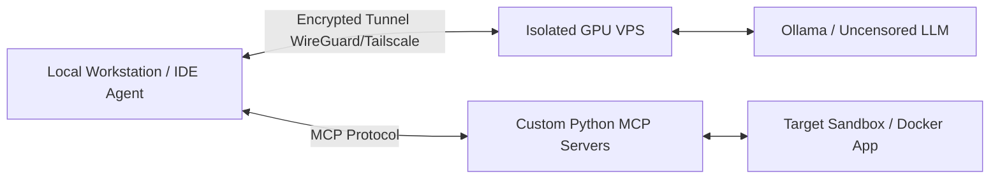

# 🛡️ Independent LLM Security Agent (`independent-LLM-agent`)

---

### 🌐 Overview / Описание / Beschreibung

* **EN:** An independent, privacy-first AI security agent powered by uncensored open-weight LLMs. Designed to run in isolated environments via encrypted tunnels, utilizing the Model Context Protocol (MCP) for automated vulnerability analysis, PoC verification, and secure code patching.
* **RU:** Независимый ИИ-агент для кибербезопасности с приоритетом на приватность, работающий на базе открытых языковых моделей без цензуры. Разработан для запуска в изолированных средах через зашифрованные туннели с использованием протокола MCP для автоматического анализа уязвимостей, проверки PoC и генерации безопасных патчей.
* **DE:** Ein unabhängiger, datenschutzorientierter KI-Sicherheitsagent auf Basis unzensierter Open-Weight-LLMs. Entwickelt für den Betrieb in isolierten Umgebungen über verschlüsselte Tunnel unter Verwendung des Model Context Protocols (MCP) zur automatisierten Schwachstellenanalyse, PoC-Verifizierung und Erstellung sicherer Code-Patches.

---

### ⚠️ Legal Disclaimer / Отказ от ответственности

> **ENGLISH:** This project is developed strictly for educational purposes, security research, and authorized penetration testing (AppSec/DevSecOps). The author does not condone or support any illegal activities. You may only use this tool against systems, networks, and applications that you own or have explicit written permission to test. The author assumes no liability and is not responsible for any misuse or damage caused by this software.
>
> **РУССКИЙ:** Данный проект создан исключительно в образовательных целях, для исследований в области информационной безопасности и авторизованного тестирования на проникновение (AppSec/DevSecOps). Автор не поощряет и не поддерживает любую незаконную деятельность. Вы можете использовать данный инструмент только в отношении систем, сетей и приложений, которыми владеете лично или на тестирование которых имеете явное письменное разрешение. Автор не несет никакой ответственности за неправомерное использование или любой ущерб, причиненный данным ПО.

---

### 🏗️ Architecture / Архитектура

---

### 🗺️ Project Roadmap / План разработки

#### Phase 1: Local Prototyping & Lightweight Model (Локальный прототип и легкая модель)
* [ ] Развертывание локального движка инференса (**Ollama**) на ноутбуке.
* [ ] Запуск и тестирование компактной модели без цензуры (например, `Bonsai-2 Uncensored 9B` или `Qwen-Coder-7B-abliterated`) для отладки вызова функций (Function Calling).
* [ ] Настройка агентской оболочки (**Cline / Roo Code**) и написание базовых системных промптов по методологии OWASP Top 10.
* [ ] Разработка первых кастомных MCP-серверов на Python (`FastMCP`) для автоматизации разведки и анализа исходного кода.

#### Phase 2: Local Sandbox & Proof-of-Concept Tests (Локальные стенды и тесты)
Поднятие изолированного уязвимого окружения в Docker на локальной машине и отработка полного цикла **«Разведка -> Поиск бага -> PoC-проверка -> Генерация патча»**:
* [ ] **Тест №1 (White-Box / SAST + Patching):** Аудит локального уязвимого веб-приложения на Python/Flask (поиск SQL-инъекции или небезопасной десериализации в исходниках), написание скрипта для подтверждения уязвимости на стенде и автоматическое исправление уязвимого участка кода с повторной проверкой.
* [ ] **Тест №2 (Black-Box / Web Recon):** Автоматизированное сканирование локального стенда (например, DVWA или OWASP Juice Shop) через кастомный MCP-инструмент (обертка над `nmap` и парсер HTTP-заголовков), выявление открытых эндпоинтов и проверка отсутствующих заголовков безопасности (CSP, HSTS, X-Frame-Options).

#### Phase 3: Private VPS Infrastructure & Tunneling (Аренда VPS и защищенный контур)
* [ ] Подбор и аренда выделенного GPU-сервера (от 24 ГБ VRAM, например RTX 3090 / 4090 / A100) у провайдера с поддержкой приватной оплаты (криптовалюта) и строгой политикой отсутствия логирования.
* [ ] Базовая защита сервера (Hardening): отключение входа по паролю (только SSH-ключи), настройка фаервола (`ufw` — закрытие всех входящих портов из публичной сети).
* [ ] Поднятие закрытого зашифрованного P2P-туннеля (**WireGuard / Tailscale**) между локальным ноутбуком и VPS, привязка API нейросети исключительно к внутреннему IP-адресу туннеля.

#### Phase 4: Production LLM Deployment & Real-World Testing (Развертывание сильной модели и аудит)
* [ ] Развертывание полноразмерной модели без цензуры на VPS (**Qwen 3.8-27B Uncensored / Abliterated** или **Hermes 4 32B**) с расширенным контекстным окном (`num_ctx` 16k–32k) для глубокого анализа больших кодовых баз и логов.
* [ ] Проведение комплексного автоматизированного аудита безопасности собственного веб-проекта (на изолированной staging-копии) с формированием итогового отчета об уязвимостях и верифицированных патчей.
